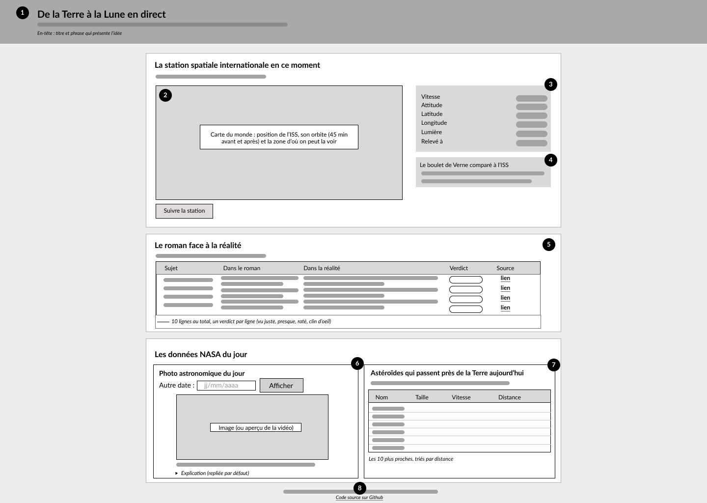
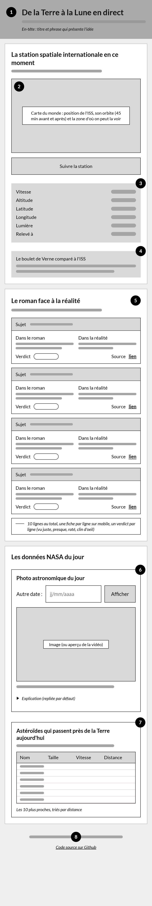
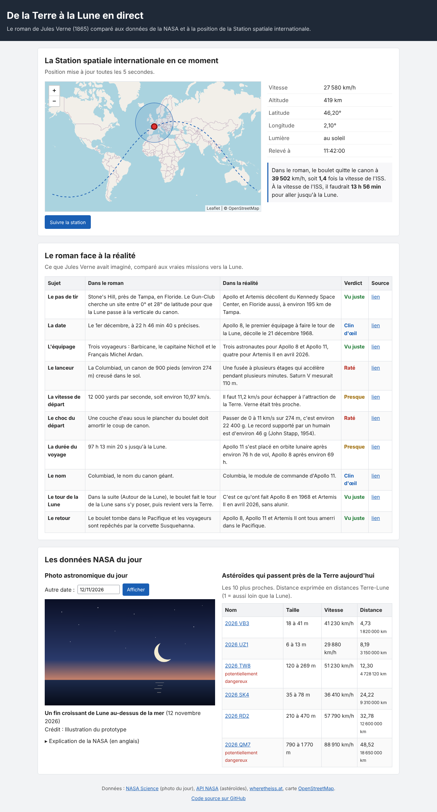

# Wireframe et maquette

Le design général de l'application : un wireframe pour la structure, puis une maquette pour le rendu final. Chacun existe en version bureau et en version mobile. (créé avec Figma)

## Wireframe

La page se lit de haut en bas, du plus vivant au plus fixe : d'abord l'ISS en direct, puis le roman comparé à la réalité, puis les données NASA du jour. Chaque zone porte un numéro.

1. **En-tête** : le titre et une phrase qui présente l'idée. On sait tout de suite de quoi parle la page.
2. **Carte de l'ISS** : c'est l'élément principal, la seule donnée vraiment en direct et la plus visuelle, donc en haut à gauche. Elle montre la position de la station, son orbite (45 minutes avant et après) et la zone d'où on peut la voir. Le bouton « Suivre la station » est juste en dessous.
3. **Infos de l'ISS** : un tableau libellé / valeur (vitesse, altitude, latitude, longitude, lumière, heure du relevé), à droite de la carte pour lire les chiffres sans faire défiler.
4. **Encadré Verne** : il fait le lien entre l'ISS et le roman, en comparant la vitesse du boulet à celle de la station. Un fond gris et une bordure à gauche le distinguent du tableau.
5. **Le roman face à la réalité** : 10 lignes, une par sujet, avec ce que dit le roman, ce qui s'est vraiment passé, un verdict et une source.
6. **Photo du jour** : le choix de la date est au-dessus de l'image, le titre et le crédit en dessous. L'explication est repliée pour ne pas allonger la page.
7. **Astéroïdes** : les 10 plus proches, triés par distance. La distance est donnée en distances Terre-Lune, plus parlant que des millions de kilomètres, avec les kilomètres en petit dessous.
8. **Pied de page** : les sources des données et le lien vers le code.

### Version mobile

Sur un écran étroit, les colonnes passent les unes sous les autres, dans le même ordre. La carte reste en premier. Le tableau comparatif garde ses 5 colonnes et défile à l'horizontale, plutôt que d'écraser le texte dans des colonnes trop étroites.

## Maquette

Version mobile : [maquette-mobile.png](maquette-mobile.png)

Les données affichées sont celles de l'API bouchon du prototype (dossier `api/` à la racine du dépôt).

### Choix graphiques

- **Couleurs** : Couleurs les plus simples (nuances de gris) pour le wireframe, bleu marine pour le projet sachant que la version finale prendra beaucoup plus compte du style général.
- **Verdicts** : vert pour « Vu juste », ocre pour « Presque », rouge pour « Raté », bleu pour « Clin d'œil ». Le mot reste écrit en entier, donc le verdict se comprend aussi sans les couleurs.
- **Police** : la police du système (Segoe UI sous Windows, San Francisco sur Mac, Roboto sur Android). Rien à télécharger, et c'est la police que l'utilisateur a l'habitude de lire. Taille de base 16 px.

### Ergonomie

- Les chiffres sont au format français : virgule pour les décimales, espace pour les milliers.
- Chaque bloc charge ses données de son côté. Si une API ne répond pas, un message rouge apparaît sous le bloc concerné avec la cause, et le reste de la page continue de marcher.
